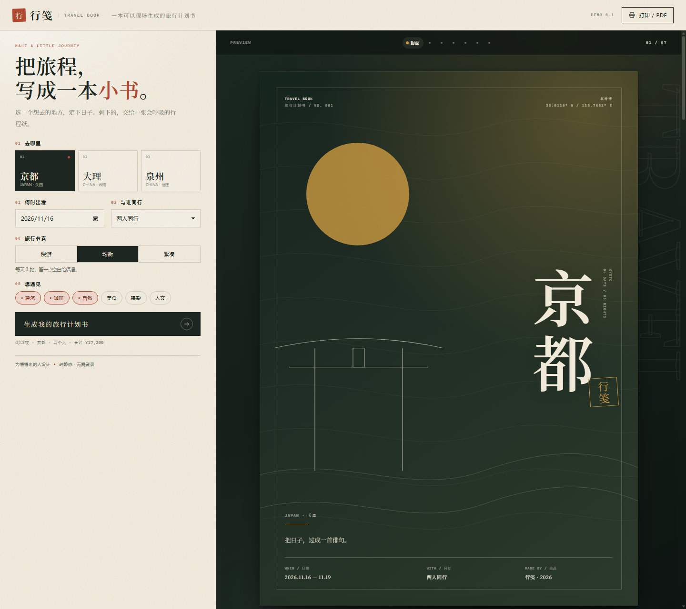

# 行笺 · Travel Book

把旅程写成一本可以打印的小书。一个纯静态、零依赖的旅行计划书生成器。



## 这是什么

选择目的地、日期、同行人、节奏和兴趣，右侧会实时生成一本 7 页的 A4 旅行计划书：

- **封面**：目的地、日期、同行人、季节与坐标
- **行程概览**：路线、预算、三个约定、目录
- **每日行程**：每天 3 站，附「如果还有时间」与「如果走慢一点」
- **账本与行囊**：预算拆分、打包清单、预订清单、手写留白
- **打印 / PDF**：一键打印成 A4，可直接装订成册

内置三个示例：**京都**（红叶季）、**大理**（风季）、**泉州**（海风季）。

## 运行

不需要安装任何依赖，也不需要构建。

```bash
# 方式一：直接用浏览器打开
start index.html

# 方式二：起一个本地静态服务器
python -m http.server 8080
# 打开 http://localhost:8080
```

> 建议用本地服务器打开，`file://` 也能运行，但部分浏览器的打印边距可能不同。

## 用法

1. 在左侧选择目的地、出发日期、同行人和节奏。
2. 点选「想遇见」的兴趣标签（最多 3 个），匹配的行程会被标记。
3. 点「生成我的旅行计划书」重新装订，或直接修改任意选项实时预览。
4. 点右上角「打印 / PDF」，在打印设置里选择 A4、无边距、背景图形，导出 PDF。

设置和打包勾选会自动保存在浏览器 `localStorage`。也支持用 URL 参数直达某个方案：

```
?dest=dali&pace=slow&party=friends&interests=自然,美食
```

## 示例计划书

- [京都 · 四日三夜 PDF](examples/kyoto-4d.pdf)
- [京都 · 四日三夜 Markdown](examples/kyoto-4d.md)

## 项目结构

```
travel-book/
├─ index.html          页面结构
├─ styles.css          版式、A4 打印样式、响应式
├─ app.js              三个目的地的行程数据 + 渲染逻辑
├─ assets/favicon.svg
├─ docs/preview.png
└─ examples/
   ├─ kyoto-4d.pdf
   └─ kyoto-4d.md
```

所有示例行程都写在 `app.js` 顶部的 `DESTINATIONS` 对象里。想换成自己的行程，只需要按同样的结构替换 `days`、`budget`、`packing` 等字段。

## 设计说明

- **纸感与克制**：米色纸张、墨绿封面、朱砂印章，衬线中文字体优先使用 Noto Serif SC / 宋体。
- **A4 优先**：页面按 210 × 297mm 设计，屏幕预览与打印共用一套版式，打印时只保留书页。
- **无图片依赖**：封面图形是内联 SVG，离线也能完整显示。
- **可访问性**：表单使用原生控件，键盘可操作，支持 `prefers-reduced-motion`。

## 下一步

这是最小 demo，接下来可以：

- 支持自定义目的地与导入自己的行程
- 接入地图 / 天气 / 汇率等真实数据
- 增加「旅行记忆」模式：上传照片，生成回程后的纪念册
- 导出带真实排版的 PDF，而不依赖浏览器打印
- 多语言与更多版式主题

---

为慢慢走的人设计。
